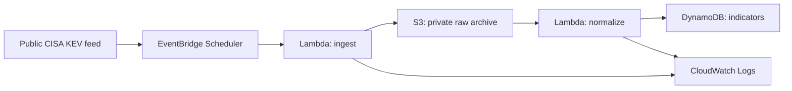

# Phase 2 — Architecture and Secure Data Foundation

**Status:** In progress. The private raw-data and normalized-data foundations, plus their least-privilege execution roles, are deployed and validated; the processing and scheduling components are not yet deployed.

## Objective

Build a small, secure, and cost-aware serverless platform that collects a public threat-intelligence feed, preserves a raw source record, and produces normalized indicators for later querying and detection exercises.

## Initial source

The first source will be the public CISA Known Exploited Vulnerabilities (KEV) catalog. It is an appropriate low-risk starting point because it is defender-focused, public, and structured as JSON.

## Planned architecture

## Security and cost decisions

| Area | Initial decision |
| --- | --- |
| Region | `us-west-2` for workload resources |
| Data ingress | Outbound HTTPS retrieval from one public source; no public upload endpoint |
| Raw storage | Private S3 bucket with Block Public Access enabled, ACLs disabled, bucket-owner-enforced ownership, versioning, and SSE-S3 encryption |
| Data lifecycle | `raw/` objects expire after 30 days; noncurrent versions and incomplete multipart uploads are removed after 7 days |
| Processing | Two dedicated Lambda execution roles: ingest can write only to the raw prefix; normalize can read that prefix and write normalized records; both have logging only beyond their assigned data access |
| Data store | DynamoDB table with a `cve_id` string primary key, on-demand mode, AWS-owned encryption, and no secondary indexes |
| Scheduling | One low-frequency scheduled ingestion run while the lab is developing |
| Logging | CloudWatch Logs with a short, deliberate retention period |
| Cost exclusions | No EC2, NAT gateway, OpenSearch, third-party feeds, managed database, public API, or automated remediation in this initial build |

## Implementation sequence

1. Create the private raw-data S3 bucket and verify its security controls. **Completed 2026-08-29.**
2. Define the DynamoDB indicator table and its access model. **Completed 2026-08-29.**
3. Create narrowly scoped Lambda execution roles. **Completed 2026-08-29.**
4. Deploy and test ingestion with a manually invoked Lambda function.
5. Add normalization, then add the schedule only after manual validation.
6. Add metrics, alerting, and a documented cleanup procedure.

## Evidence rules

Document high-level configuration and validation results only. Never store bucket names, account identifiers, role ARNs, portal URLs, raw logs, source copies, credentials, or unredacted screenshots in this repository.

## Completed storage foundation

The raw-data archive was created in `us-west-2` and validated before any feed data was uploaded.

- General-purpose S3 bucket with no objects present at validation.
- Block Public Access enabled; no bucket policy configured.
- ACLs disabled and object ownership set to bucket owner enforced.
- Versioning enabled with default SSE-S3 encryption.
- Portfolio tags applied: `Project=aws-threat-intel`, `Environment=lab`, and `DataClass=public-threat-intel`.
- Lifecycle rule is limited to the future `raw/` prefix: current objects expire after 30 days, noncurrent versions are permanently removed after 7 days, and incomplete multipart uploads are aborted after 7 days.

The normalized-data foundation was then established. No threat-intelligence data has been ingested yet.

## Completed normalized-data foundation

The normalized-indicator table was created empty and validated before any ingestion code was deployed.

- A single `cve_id` string partition key maps one normalized record to each CVE identifier; no sort key is needed for the initial feed.
- On-demand read and write capacity avoids pre-provisioned throughput for this small, developing lab.
- DynamoDB Standard table class with AWS-owned encryption was retained.
- No local or global secondary indexes, replica Regions, or resource-based policy were created.
- Deletion protection remains off while the table is empty and the lab design is still evolving; it will be reconsidered once the ingestion path is validated.

The least-privilege execution roles were then established. No threat-intelligence data has been ingested yet.

## Completed execution-role foundation

Two distinct Lambda-trusted execution roles were created for the planned functions. Both retain the AWS-managed basic execution policy for CloudWatch Logs and have no long-lived access keys.

- The ingestion role has one inline permission: write objects only to the private S3 `raw/` prefix. It cannot read, list, or delete S3 objects.
- The normalization role can read objects only from that same S3 prefix and write normalized records only to the indicator table. It has no scan, delete, or broad data-store permissions.
- No administrative, broader S3 or DynamoDB, or cross-account permissions were attached.
- Roles were tagged for project, environment, and component ownership.

The next implementation step is to deploy and manually test the ingestion Lambda function. No threat-intelligence data has been ingested yet.

## Prepared ingestion implementation

The dependency-free Python handler is source-controlled in [`src/ingest/`](../../src/ingest/). It is intentionally not configured with any live values in this repository.

- Retrieves one bounded response from the public CISA KEV JSON source over HTTPS.
- Validates the expected JSON shape before it writes to S3.
- Writes a checksummed raw record only under the dedicated `raw/` prefix with SSE-S3 requested.
- Requires the private raw bucket name through a Lambda environment variable configured in the console, not source code.
- Has not yet been deployed or invoked in AWS.

