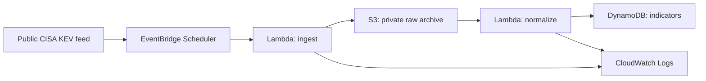

# Phase 2 — Architecture and Secure Data Foundation

**Status:** In progress. This document describes the approved lab design; it does not claim that the workload has been deployed.

## Objective

Build a small, secure, and cost-aware serverless platform that collects a public threat-intelligence feed, preserves a raw source record, and produces normalized indicators for later querying and detection exercises.

## Initial source

The first source will be the public CISA Known Exploited Vulnerabilities (KEV) catalog. It is an appropriate low-risk starting point because it is defender-focused, public, and structured as JSON.

## Planned architecture

## Security and cost decisions

| Area | Initial decision |
| --- | --- |
| Region | `us-west-2` for workload resources |
| Data ingress | Outbound HTTPS retrieval from one public source; no public upload endpoint |
| Raw storage | Private S3 bucket, Block Public Access enabled, ACLs disabled, versioning enabled, server-side encryption at rest |
| Processing | Two dedicated Lambda functions with separate least-privilege execution roles; no long-lived access keys |
| Data store | DynamoDB on-demand mode for normalized records; no provisioned capacity |
| Scheduling | One low-frequency scheduled ingestion run while the lab is developing |
| Logging | CloudWatch Logs with a short, deliberate retention period |
| Cost exclusions | No EC2, NAT gateway, OpenSearch, third-party feeds, managed database, public API, or automated remediation in this initial build |

## Implementation sequence

1. Create the private raw-data S3 bucket and verify its security controls.
2. Define the DynamoDB indicator table and its access model.
3. Create narrowly scoped Lambda execution roles.
4. Deploy and test ingestion with a manually invoked Lambda function.
5. Add normalization, then add the schedule only after manual validation.
6. Add metrics, alerting, and a documented cleanup procedure.

## Evidence rules

Document high-level configuration and validation results only. Never store bucket names, account identifiers, role ARNs, portal URLs, raw logs, source copies, credentials, or unredacted screenshots in this repository.
