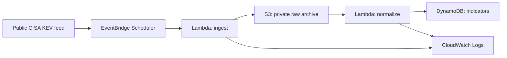

# Phase 2 — Architecture and Secure Data Foundation

**Status:** Completed. The private raw-data and normalized-data foundations, least-privilege execution roles, ingestion function, normalization function, S3 event path, and daily scheduler are deployed and validated.

## Objective

Build a small, secure, and cost-aware serverless platform that collects a public threat-intelligence feed, preserves a raw source record, and produces normalized indicators for later querying and detection exercises.

## Initial source

The first source will be the public CISA Known Exploited Vulnerabilities (KEV) catalog. It is an appropriate low-risk starting point because it is defender-focused, public, and structured as JSON.

## Planned architecture

## Security and cost decisions

| Area | Initial decision |
| --- | --- |
| Region | `us-west-2` for workload resources |
| Data ingress | Outbound HTTPS retrieval from one public source; no public upload endpoint |
| Raw storage | Private S3 bucket with Block Public Access enabled, ACLs disabled, bucket-owner-enforced ownership, versioning, and SSE-S3 encryption |
| Data lifecycle | `raw/` objects expire after 30 days; noncurrent versions and incomplete multipart uploads are removed after 7 days |
| Processing | Two dedicated Lambda execution roles: ingest can write only to the raw prefix; normalize can read that prefix and batch-write normalized records; both have logging only beyond their assigned data access |
| Data store | DynamoDB table with a `cve_id` string primary key, on-demand mode, AWS-owned encryption, and no secondary indexes |
| Scheduling | One enabled EventBridge Scheduler run each day at 8:15 AM Pacific, with its own least-privilege invocation role and no flexible time window |
| Logging | CloudWatch Logs with a 14-day retention period |
| Cost exclusions | No EC2, NAT gateway, OpenSearch, third-party feeds, managed database, public API, or automated remediation in this initial build |

## Implementation sequence

1. Create the private raw-data S3 bucket and verify its security controls. **Completed 2026-08-29.**
2. Define the DynamoDB indicator table and its access model. **Completed 2026-08-29.**
3. Create narrowly scoped Lambda execution roles. **Completed 2026-08-29.**
4. Deploy and test ingestion with a manually invoked Lambda function. **Completed 2026-08-29.**
5. Deploy and manually validate normalization, then add the S3 object-created trigger. **Completed 2026-09-03.**
6. Add the low-frequency daily scheduler after the full S3-triggered path succeeds. **Completed 2026-09-03.**
7. Next: add metrics, alerting, and a documented cleanup procedure.

## Evidence rules

Document high-level configuration and validation results only. Never store bucket names, account identifiers, role ARNs, portal URLs, raw logs, source copies, credentials, or unredacted screenshots in this repository.

## Completed storage foundation

The raw-data archive was created in `us-west-2` and validated before any feed data was uploaded.

- General-purpose S3 bucket with no objects present at validation.
- Block Public Access enabled; no bucket policy configured.
- ACLs disabled and object ownership set to bucket owner enforced.
- Versioning enabled with default SSE-S3 encryption.
- Portfolio tags applied: `Project=aws-threat-intel`, `Environment=lab`, and `DataClass=public-threat-intel`.
- Lifecycle rule is limited to the future `raw/` prefix: current objects expire after 30 days, noncurrent versions are permanently removed after 7 days, and incomplete multipart uploads are aborted after 7 days.

The normalized-data foundation was then established. No threat-intelligence data has been ingested yet.

## Completed normalized-data foundation

The normalized-indicator table was created empty and validated before any ingestion code was deployed.

- A single `cve_id` string partition key maps one normalized record to each CVE identifier; no sort key is needed for the initial feed.
- On-demand read and write capacity avoids pre-provisioned throughput for this small, developing lab.
- DynamoDB Standard table class with AWS-owned encryption was retained.
- No local or global secondary indexes, replica Regions, or resource-based policy were created.
- Deletion protection remains off while the table is empty and the lab design is still evolving; it will be reconsidered once the ingestion path is validated.

The least-privilege execution roles were then established. No threat-intelligence data has been ingested yet.

## Completed execution-role foundation

Two distinct Lambda-trusted execution roles were created for the planned functions. Both retain the AWS-managed basic execution policy for CloudWatch Logs and have no long-lived access keys.

- The ingestion role has one inline permission: write objects only to the private S3 `raw/` prefix. It cannot read, list, or delete S3 objects.
- The normalization role can read objects only from that same S3 prefix and use `PutItem` or `BatchWriteItem` only on the indicator table. It has no scan, delete, or broad data-store permissions.
- No administrative, broader S3 or DynamoDB, or cross-account permissions were attached.
- Roles were tagged for project, environment, and component ownership.

The next implementation step is to deploy and manually test the ingestion Lambda function. No threat-intelligence data has been ingested yet.

## Prepared ingestion implementation

The dependency-free Python handler is source-controlled in [`src/ingest/`](../../src/ingest/). It is intentionally not configured with any live values in this repository.

- Retrieves one bounded response from the public CISA KEV JSON source over HTTPS.
- Validates the expected JSON shape before it writes to S3.
- Writes a checksummed raw record only under the dedicated `raw/` prefix with SSE-S3 requested.
- Requires the private raw bucket name through a Lambda environment variable configured in the console, not source code.
- Was prepared without live configuration values before deployment; deployment and validation results follow.

## Completed ingestion validation

The ingestion function was deployed with the dedicated ingestion role and validated through one manual invocation.

- The function retrieved the public CISA KEV JSON feed and created one raw snapshot below the private S3 `raw/` prefix.
- The successful response confirmed source identity, a catalog version, object-key location, a SHA-256 checksum, and byte count. Those execution-specific values are intentionally not preserved here.
- Its CloudWatch log group uses the Standard log class with 14-day retention. Deletion protection remains off for this short-lived lab workload.
- The initial configuration error was limited to a nonmatching bucket environment value; correcting the console-only value allowed the next invocation to succeed without broadening the role permissions.
- The function has no public function URL and no VPC attachment. No source payload, event details, execution identifiers, or log output are committed to this repository.

The next implementation step was the normalization Lambda function and its event path.

## Prepared normalization implementation

The dependency-free normalization handler is source-controlled in [`src/normalize/`](../../src/normalize/). It is intentionally not configured with any live values in this repository.

- Accepts S3 notification events only for the CISA KEV private raw-data prefix and validates the catalog before it writes indicators.
- Keeps a compact, query-oriented set of fields keyed by `cve_id`, with source metadata and a reference to the protected raw object.
- Uses idempotent DynamoDB batch writes to the existing table; reprocessing a raw object updates its CVE records rather than creating duplicates.
- Requires the indicator table name through a Lambda environment variable configured in the console, not source code.
- Requires only the already established S3 read and narrowly scoped DynamoDB `PutItem`/`BatchWriteItem` permissions.

## Completed normalization and event-path validation

The normalization function was deployed with the dedicated normalization role and verified before automation was enabled.

- A manually supplied Amazon S3 put event for one protected raw snapshot completed successfully and wrote normalized CVE-keyed records to DynamoDB.
- Its CloudWatch log group uses the Standard log class with 14-day retention. Deletion protection remains off for this short-lived lab workload.
- An S3 object-created trigger is limited to the private `raw/cisa-kev/` prefix and `.json` suffix. Lambda added the resource permission that allows only this configured S3 notification to invoke the function.
- A second ingestion invocation created a new raw snapshot and automatically invoked normalization. CloudWatch Logs confirmed a normal completion with no error entries.
- Reprocessing remains idempotent because writes use `cve_id` as the DynamoDB key.

## Completed scheduled operation

One enabled EventBridge Scheduler schedule invokes the ingestion function every day at 8:15 AM in the `America/Los_Angeles` time zone.

- The schedule uses a dedicated invocation role created for the scheduler; it does not reuse either Lambda execution role.
- Flexible time windows are disabled so the target is invoked at the intended daily time.
- The ingestion function accepts the scheduler's empty JSON event and continues to retrieve the public CISA KEV source. Its S3 write then begins the already-validated normalization path.

No live resource identifiers, source payloads, raw data, event payloads, request identifiers, or log output are preserved in this repository.

