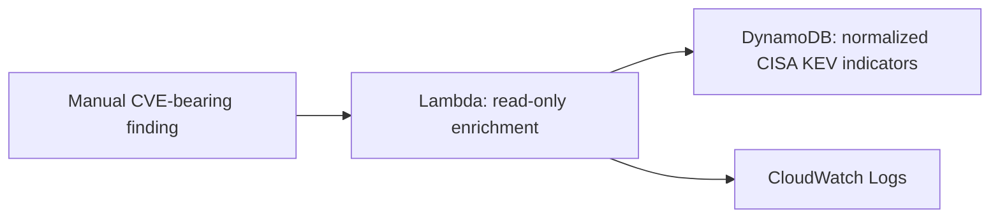

# Phase 3 — Finding Enrichment and Triage Foundation

**Status:** Completed. A manually invoked, read-only enrichment function can retrieve compact CISA KEV context for one CVE-bearing finding. No automatic source, public endpoint, or remediation action is configured.

## Objective

Turn the normalized threat-intelligence data from Phase 2 into a safe investigation primitive: given a single CVE identifier, determine whether it is in the CISA Known Exploited Vulnerabilities catalog and return only the context needed to prioritize follow-up work.

## Implemented flow

## Security decisions

| Area | Decision |
| --- | --- |
| Data access | One exact `dynamodb:GetItem` lookup by `cve_id`; no scan, query, write, delete, list, or index permission |
| Execution role | Dedicated Lambda-trusted role with AWS-managed basic logging plus only the exact table read permission |
| Network exposure | No VPC attachment and no public Function URL |
| Configuration | Indicator table name is a Lambda console environment variable and is never committed |
| Output | Compact KEV context only; raw object locations and raw source content are omitted |
| Logging | Operational boolean match result only; Standard log class with 14-day retention |
| Automation | Manual test invocation only; no EventBridge source, alert target, or remediation action |

## Validation result

The enrichment function was deployed and manually tested using an existing normalized CISA KEV record.

- It returned a known-exploited match and a prioritize triage outcome.
- It returned compact vendor, product, vulnerability, remediation, and CWE context without exposing the protected raw object reference.
- The successful invocation validated the exact-key DynamoDB read, console-only environment configuration, function code, and least-privilege role together.
- No live CVE, table name, event, output, execution identifier, log content, or screenshot is retained in this repository.

## Next phase

Design a narrow automatic detection source and email-only notification path before connecting events to enrichment. The design should preserve the same constraints: one trusted source, explicit event validation, no public endpoint, no automated remediation, no raw data in alerts, and an auditable recovery path.

