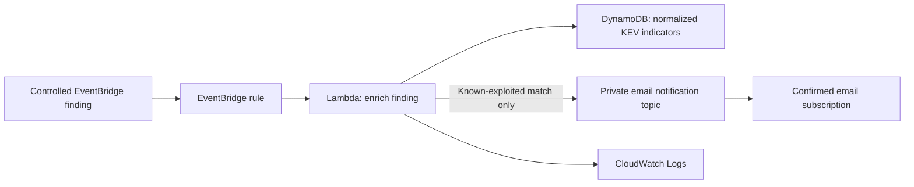

# Phase 4 — Event-Driven KEV Triage and Alerting

**Status:** Completed with a controlled EventBridge source. The Amazon Inspector integration rule is prepared but the Inspector service is intentionally not activated.

## Objective

Turn a CVE-bearing event into a small, reviewable triage decision: enrich it with normalized CISA Known Exploited Vulnerabilities (KEV) context and send an email only when the CVE is a known-exploited vulnerability.

## Implemented flow

## Validation outcome

A controlled finding event was sent through the default EventBridge bus and matched the dedicated rule. The enrichment function was invoked, made one exact DynamoDB lookup, identified a known-exploited CVE, and published one email alert through the existing private notification topic.

This validates the event-to-triage-to-notification path without a public endpoint, an external webhook, automated remediation, raw-data exposure, or a paid detection service.

## Security decisions

| Area | Decision |
| --- | --- |
| Event scope | The controlled rule matches only the lab's custom event source and detail type. |
| Real-source readiness | A separate rule matches only active Amazon Inspector package-vulnerability findings. |
| Data access | Enrichment retains one exact `dynamodb:GetItem` lookup by CVE identifier. |
| Alert authorization | The enrichment role may use `sns:Publish` only against the existing alert topic. |
| Alert behavior | Only known-exploited matches are published; nonmatches produce no email. |
| Data minimization | Alerts include compact KEV context, never the protected raw object location or an event payload dump. |
| Exposure | No public Function URL, API endpoint, cross-account target, or automatic remediation is configured. |
| Logging | Logs retain operational match and alert status only, without CVE values, payloads, topic identifiers, or indicator fields. |

## Inspector boundary

The enrichment handler supports the documented package-vulnerability CVE field from an Amazon Inspector finding event, and a dedicated rule is ready to receive active package-vulnerability findings.

Amazon Inspector remains unactivated. The organization activation screen required an Inspector delegated-administrator account and an organization-policy update. That governance change is intentionally deferred rather than being treated as a temporary lab toggle. No Inspector free trial, scan, finding, or charge was initiated.

## Non-goals

- Enabling Amazon Inspector or appointing an organization delegated administrator
- Scanning EC2 instances, ECR images, Lambda code, repositories, or third-party systems
- Sending alerts for non-KEV findings
- Creating public endpoints, webhooks, tickets, or automatic remediation
- Committing account-specific events, topic identifiers, recipients, CVE test values, logs, or screenshots

## Next operational focus

Phase 5 records how to verify EventBridge changes, triage an alert, and preserve the least-privilege and no-new-service boundary.

