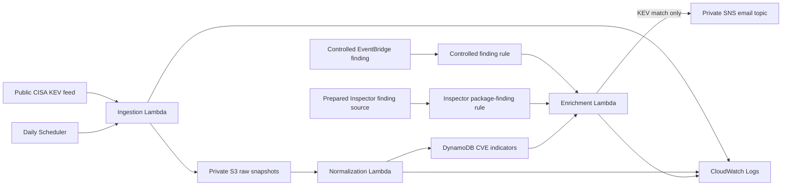

# Phase 6 — Infrastructure-as-Code Readiness and Architecture

**Status:** In progress. The live lab remains manually deployed; this phase adds a sanitized, reference-only infrastructure blueprint and architecture record without deploying new resources.

## Architecture view

## Source-controlled representation

[`infrastructure/template.yaml`](../../infrastructure/template.yaml) represents the major serverless components and their least-privilege permissions using AWS SAM syntax. It is a greenfield reference, not an adoption or deployment plan for the existing resources.

The template intentionally creates resources with generated names and has no account-specific parameters. It preserves the architecture's key boundaries:

- private raw-data storage with lifecycle controls;
- on-demand, CVE-keyed normalized data;
- separate Lambda roles with purpose-limited actions;
- a local-time scheduled ingestion run;
- one controlled event route and one prepared Inspector-compatible route;
- email-only alerts for known-exploited matches; and
- 14-day CloudWatch log retention for each function; and
- no public endpoint or automatic remediation.

## Why this is reference-only

The live lab was created and validated manually. Importing existing resources into CloudFormation or deploying an overlapping template would require a separate change plan and could create duplicate resources, notifications, invocations, or costs.

For that reason, the template is retained as evidence of infrastructure-as-code readiness. It will not be deployed without a fresh-account design, change-set review, budget review, and explicit authorization.

## Validation boundary

- The template is manually reviewed for YAML structure; full SAM validation is deferred until a dedicated deployment environment is approved.
- No AWS SAM package, deploy, change set, Inspector activation, CloudTrail trail, or organization-policy update is run in this phase.
- The existing manually validated workflow remains the operational reference.

## Portfolio talking point

The project demonstrates both hands-on AWS configuration and the ability to express the same security boundaries in reviewable infrastructure source. The template deliberately separates reusable architecture from live account identifiers and treats deployment as a governed security change rather than a documentation exercise.

